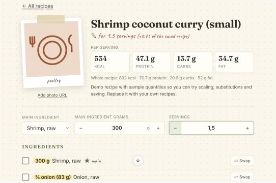

# Recipe Notebook for ChatGPT

An MCP server and a notebook-style panel (MCP App) for saving recipes and working with them in chat:

- **Scale the whole recipe** by the grams of its main ingredient (“I only have 100 g of shrimp”) or by servings.
- **Swap ingredients**: suggestions show the macro difference for the amount the recipe actually uses.
- **Macros** (total and per serving) are always calculated from per-100 g values for each ingredient. The model never estimates them.
- **Previews are never saved by accident.** Scaling and swapping are previews until you choose **Save** (overwrite) or **Save copy** (new recipe, editable title).
- Each user has their own account, recipes and custom ingredients (OAuth 2.1).



## Requirements

- Node.js **22.13 or later** (uses the built-in `node:sqlite`; developed on Node 24)
- npm

## Install and run

```bash
npm install
```

```bash
npm run build
```

```bash
npm start
```

The server listens on `http://127.0.0.1:3000`. The MCP endpoint is **`http://localhost:3000/mcp`**.

For development, `npm run dev` builds the panel once and restarts the server when files change.

Run all checks (typecheck, tests, build):

```bash
npm run check
```

### Environment variables

Copy `.env.example` to `.env` if you want to change anything. Every variable has a default, and no secrets are needed because the server is its own OAuth provider.

| Variable | Default | Purpose |
|---|---|---|
| `PORT` / `HOST` | `3000` / `127.0.0.1` | Where the HTTP server listens |
| `PUBLIC_URL` | `http://localhost:3000` | Public origin. Used as the OAuth issuer and the protected resource (`PUBLIC_URL/mcp`). **Must match the URL clients connect to.** |
| `DATABASE_PATH` | `./data/recipe-notebook.db` | SQLite file (users, OAuth, ingredients, recipes) |
| `PHOTO_DOMAINS` | Unsplash, Imgur, Wikimedia | Image origins the panel may load (added to the panel CSP) |

## Connect it to MCPJam

1. Start the server (`npm start`).
2. Start MCPJam: `npx @mcpjam/inspector@latest`. If port 6274 is busy, add `--port 6280`. Open the link with `#token=…` that it prints.
3. Choose **Connect** (or **Add Server**), enter `http://localhost:3000/mcp` and connect.
4. MCPJam gets a 401 from the server and shows **Authorize**. Click it. On the *Recipe Notebook* sign-in page, choose **Create account** the first time; after that, choose **Sign in**. Your account starts with a demo recipe.
5. MCPJam should report *7 tools ready*. Open the **Playground**:
   - Pick `open_recipe` in the tool list and click **Run** with no arguments. This is what ChatGPT's thread entry point sends (`{}`), and it shows your recipe library in the panel.
   - Or chat with the model using the prompts below.

> **After restarting the server**, MCP sessions (kept in memory) are gone. The server answers stale session IDs with `404 Session not found`, as the MCP spec requires, but MCPJam does not start a new session on its own. Turn the server's switch off and on again in MCPJam (**Connect → Servers**). Your account, OAuth tokens and recipes are stored in SQLite and survive restarts.

MCPJam supports standard MCP form elicitation. In MCPJam, `suggest_substitutes` and `save_recipe` (when no `mode` is given) show forms without thumbnails. See [Host capabilities and fallbacks](#host-capabilities-and-fallbacks).

## Connect it to ChatGPT

ChatGPT needs a public **HTTPS** URL:

1. Expose the server, for example with `cloudflared tunnel --url http://localhost:3000` or `ngrok http 3000`.
2. Set `PUBLIC_URL` to that origin (for example `PUBLIC_URL=https://abc.trycloudflare.com`) and restart. The issuer, resource metadata and token audience all use it.
3. In ChatGPT, add a custom MCP server or plugin with the URL `https://…/mcp`. ChatGPT discovers OAuth through `/.well-known/oauth-protected-resource/mcp`, registers itself through Dynamic Client Registration, and opens the sign-in page.
4. Plugin extensions (thread panel, extended forms) are ChatGPT **Work / Desktop** features. See the [Extensions guide](https://developers.openai.com/plugins/build/extensions) and the [auth guide](https://developers.openai.com/apps-sdk/build/auth) for the current setup steps and plan availability.

## Test prompts

Use them in order, either in MCPJam's Playground or in ChatGPT:

1. **Open:** “Open my coconut curry recipe.”
2. **Scale by grams:** “I only have 100 g of chicken. Scale the curry to that.” Every scalable item gets factor 0.125; oil and salt stay fixed.
3. **Scale by servings:** “Show it for 6 servings instead.”
4. **Ambiguous input (should be refused):** “Scale it to 300 g of chicken and 2 servings at the same time.”
5. **Substitute:** “What can I use instead of the Greek yogurt?” Then: “Use sour cream.”
6. **Check nothing was saved:** “Reopen the original curry. Is it still 800 g of chicken?”
7. **Save a copy:** “Save this version as a copy called ‘Curry for one’.”
8. **Overwrite and fix steps:** “Overwrite ‘Curry for one’ as 2 servings and rewrite the steps for shrimp.”
9. **Reopen:** “List my recipes with their main ingredient, then open ‘Curry for one’.”
10. **Custom ingredient:** “Add my protein bar: Acme, 380 kcal, 33 g protein, 40 g carbs, 12 g fat per 100 g, one bar is 60 g.”
11. **New recipe:** “Save this recipe: omelette for 1 with 3 eggs (main), 30 g cheddar and salt to taste. Steps: beat the eggs with the salt, cook, fold in the cheese.”

In the panel you can also try:

- the grams and servings steppers (instant, no tool call)
- the main-ingredient selector
- **⇄ Swap** (suggestions with thumbnails, then **Undo**)
- “Create an ingredient” for a branded product
- the ingredient and step checkboxes
- **Save** / **Save copy** / **Reset**

## Tools

| Tool | What it does | UI |
|---|---|---|
| `list_recipes` | The user's recipes (all words of `query` must match the title), with servings, kcal/serving and the main ingredient | text |
| `open_recipe` | Opens a recipe, optionally previewed with `mainGrams` **or** `servings`. With no `recipeId`, shows the library. | panel + **thread entry point** |
| `adjust_recipe` | Preview with scaling and/or `substitutions`. Each call is relative to the saved recipe. | panel |
| `suggest_substitutes` | Ranked replacements with the macro difference for the amount used. Shows a form when the client supports one; otherwise returns a list. | form / text |
| `search_ingredients` | Searches the USDA base plus the user's own ingredients | text |
| `create_ingredient` | Private custom ingredient (supports brands). Missing values: form, or a clear error | form / text |
| `save_recipe` | `recipe` creates a new recipe. `recipeId` + adjustment + `mode: overwrite \| copy` saves a preview, optionally with new `steps`, `title`, `photoUrl`. No `mode`: form, or a clear error. | panel |

Every tool requires OAuth (`securitySchemes: [{ type: "oauth2", scopes: ["recipes"] }]`) and reads the user from the verified access token. No tool takes an owner or user ID.

## How the calculation works

`src/shared/recipe-math.ts` is the only implementation. The server and the panel import the same file.

- A preview is `computePreview(savedRecipe, adjustment)`. An adjustment (`mainGrams` | `servings`, `mainItemId`, `substitutions[]`) always describes the change from the **saved** recipe, so repeated adjustments never multiply each other.
- `factor = mainGrams / savedMainGrams` or `servings / savedServings`. Sending both is rejected (`ambiguous_scale`). Without a main ingredient, only scaling by servings is allowed.
- Only items with `scalable = true` are scaled. Fixed items, like oil for the pan or salt to taste (`0 g`), keep their amount.
- A substitution keeps the item's grams unless `grams` is given, and that override changes only that item.
- Macros = Σ (value per 100 g × grams / 100). Per serving = totals / servings.
- Steps reference items as `{item:<id>}` and are rendered with the current ingredient and amount, so step text follows scaling and swaps. Copies get new item IDs, and step references are remapped.
- Full precision is stored and calculated. Rounding happens only in the `format*` display helpers.
- Saving recalculates the preview on the server from the saved recipe plus the adjustment. What gets stored is exactly what was shown, and reopening returns it unchanged.

## Ingredient database

`data/ingredients.json` has **143 curated ingredients** from **USDA FoodData Central, SR Legacy (April 2018)**. Each one is pinned to an FDC ID and keeps the USDA description in `source`.

- Values: kcal (nutrient 1008), protein (1003), carbohydrate by difference (1005), total fat (1004), all per 100 g.
- Raw, cooked, dry and canned versions are separate entries where it matters (chicken, beef, salmon, shrimp, rice, pasta, quinoa, lentils, chickpeas, beans, potatoes…).
- Unit weights (1 large egg = 50 g, 1 garlic clove = 3 g, 1 medium onion = 110 g…) come from the USDA portion table.
- Regenerate with `python3 -I scripts/build_ingredients.py <path-to-FoodData_Central_sr_legacy_food_csv_2018-04> data/ingredients.json`. The script fails if any ID, nutrient or portion is missing.

Custom ingredients (`create_ingredient`, or the panel form) are private to their owner and can include a brand.

## Demo recipe

New accounts get **“DEMO · Coconut chicken curry”**. It is labelled *demo data* in the panel and is **not a tested recipe**: its amounts are sample values chosen to exercise the features (an 800 g main ingredient, fixed oil, “salt to taste”, unit-based onions and garlic). No starting recipe existed in the project, so nothing was copied from an existing source. Its macros come from the USDA base. Delete or overwrite it once you add your own recipes.

## Photos

`photoUrl` accepts `https://` URLs. Without a photo, the panel shows an illustration based on the recipe category. The host's CSP only allows images from the origins listed in `PHOTO_DOMAINS`. Photos from any other origin fall back to the illustration, so add your image host there.

## Host capabilities and fallbacks

Checked against the [OpenAI Extensions guide](https://developers.openai.com/plugins/build/extensions), the [MCP extensions spec and SDK README](https://github.com/openai/mcp-extensions) and the [auth guide](https://developers.openai.com/apps-sdk/build/auth):

| Capability | Implementation | Limitation and fallback |
|---|---|---|
| UI resource | `ui://recipe-notebook/notebook-v1.html`, `text/html;profile=mcp-app`, linked through `_meta.ui.resourceUri`; `_meta["openai/ui"].availableDisplayModes` | Hosts without MCP Apps get full text results |
| Thread entry point | `open_recipe` declares `_meta["openai/ui"].entrypoints: [{ type: "thread" }]` and handles `{}` by showing the library | ChatGPT Work / Desktop / mobile only; “classic” ChatGPT is excluded by the spec |
| Extended (rich) forms | `openai/elicitation/create` with `oneOf` + `description` + `x-openai-thumbnail` (inline SVG data URIs), validated with `@openai/mcp-extensions` schemas | Used only when the client advertises `extensions["openai/elicitation"].form`. Spec: Desktop yes, web partial, mobile no. **OpenAI-registered servers need MCP `2026-07-28` + MRTR for forms.** The published `@openai/mcp-extensions@0.1.0` targets MCP SDK v1 (protocol `2025-11-25`), so this server uses the legacy flow, which the docs say works for direct MCP connections. |
| Standard forms | `elicitation/create` with titled options | Used by MCPJam and other clients that support elicitation |
| No forms | Tools return lists or clear errors; the panel has its own swap / create-ingredient / save-copy forms | — |
| Auth | OAuth 2.1 auth code + PKCE S256, Dynamic Client Registration, RFC 9728 protected resource metadata, RFC 8414 AS metadata, refresh-token rotation, `resource` bound to the token audience | No CIMD and no mTLS client verification (both optional per the guide); DCR covers registration |

Left out of v1 on purpose: events and triggers, the sidebar library (global entry point), shopping list and weekly menu.

## Project layout

```
src/shared/recipe-math.ts   single calculation engine (server + panel)
src/shared/placeholders.ts  illustrated placeholders and form thumbnails
src/server/                 HTTP app, OAuth provider, MCP tools, forms, SQLite, recipe service
src/panel/                  notebook panel (vanilla TS, built into one HTML file by Vite)
data/ingredients.json       curated USDA ingredient base
scripts/build_ingredients.py
tests/                      math, service (persistence + isolation) and end-to-end (HTTP + OAuth + MCP)
```
